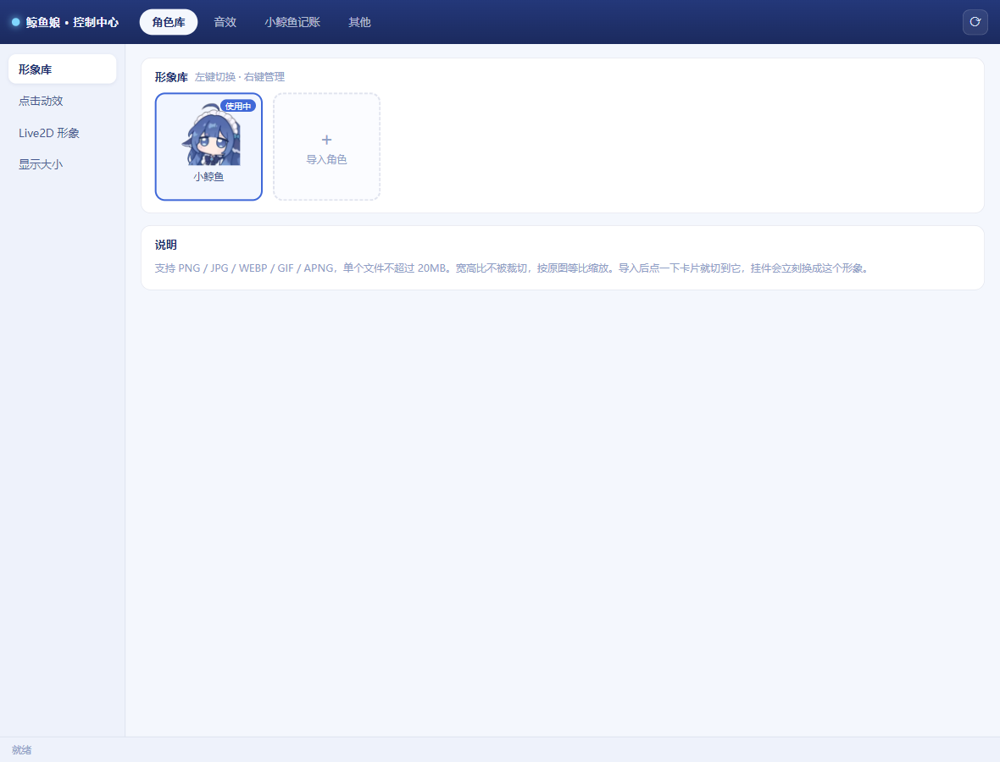
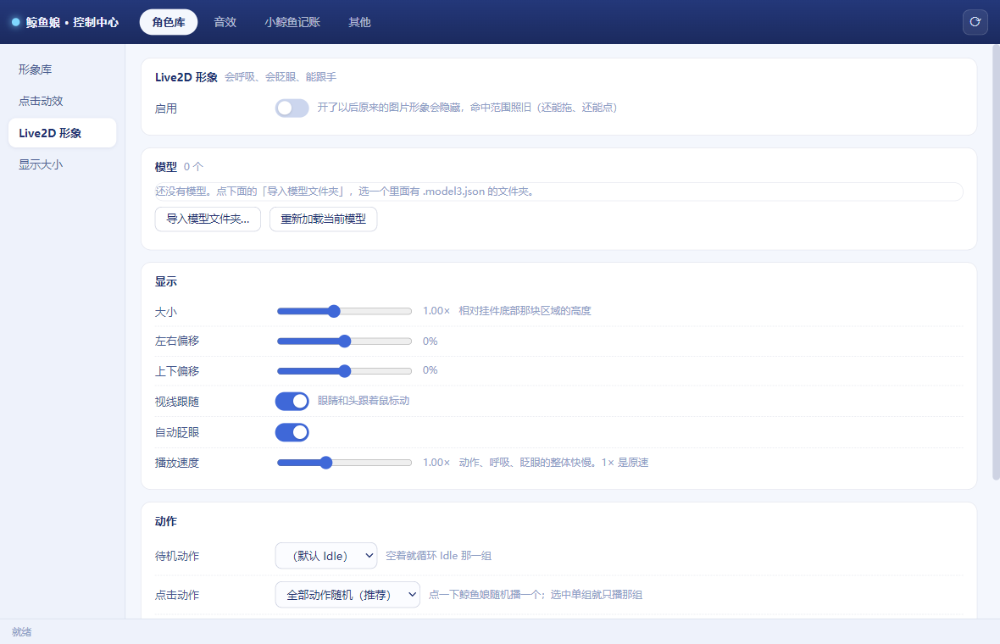
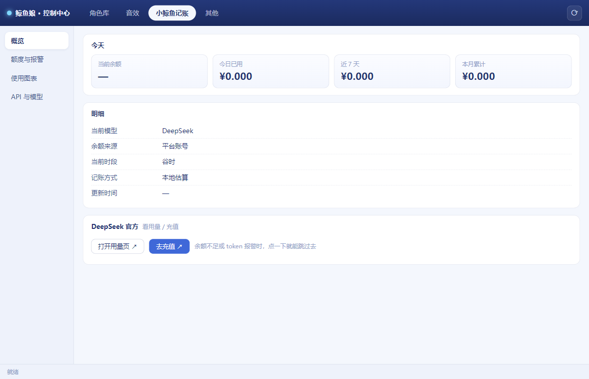
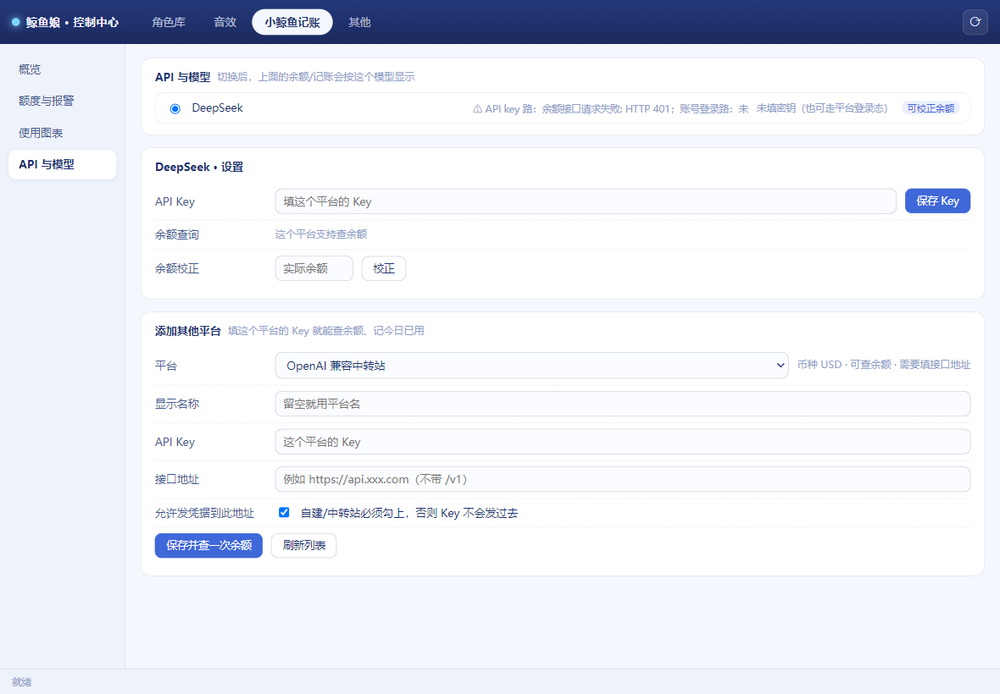

# 小鲸鱼挂件 · 桌面增强升级包（dsh-whale-widget-upgrade）

> 这是给 **DSH 小鲸鱼余额挂件** 用的桌面端增强包。它本身**不含挂件本体**（挂件脚本、角色素材、Live2D 库全部从原插件读取），
> 必须先装好原插件才能跑起来。

原插件地址：https://github.com/MeteorNOX/DeepSeek-Balance-Whale-Widget

- 升级包本体：`dsh-whale-widget-upgrade-1.0.0.zip`（约 0.4 MB，不含 node_modules）
- 运行方式：Electron 独立小窗口，托盘常驻，挂件贴在屏幕右下角，鼠标穿透
- 依赖：Windows 10/11 + Node.js 18+ + 原插件 `dsh-whale-widget`（≥ 0.4.0）

---

## 一、功能介绍

### 1. 桌面挂件本体

把原插件的网页挂件搬到桌面，变成一块可以贴边、可以穿透鼠标的小窗：不挡操作、不抢焦点，点一下就冒泡泡。


### 2. 控制中心（集中所有设置）

一个界面管全部设置：角色库、音效、小鲸鱼记账、其他。左侧一级页签，右侧二级页签，改完立刻生效，不用重启。



- **形象库**：导入 PNG / JPG / WEBP / GIF / APNG 角色图（单文件 ≤ 20MB），左键切换、右键管理
- **点击动效**：按压缩放开关、运动幅度（0–30%）、运动速度（60–600ms），可一键恢复出厂 12% / 220ms
- **Live2D 形象**：见下一条
- **音效**：点击音效、每轮消耗音效、音量
- **其他**：开机自启、窗口置顶、吸附边距、调试与资源管理

### 3. Live2D 形象层（可以呼吸、会眨眼、能跟手）

在挂件位置叠一层真正的 Live2D 模型（Cubism 3/4），原来的图片形象自动隐藏但命中范围保留，所以「能拖、能点」的手感不变。



- 导入模型文件夹（内含 `.model3.json` 即可），可多模型切换
- 大小缩放、左右/上下偏移微调
- 视线跟随（眼睛和头跟着鼠标动）、自动眨眼开关
- **播放速度** 0.2×–2.5×，动作/呼吸/眨眼/物理整体快慢
- 待机动作组、点击动作组可指定；支持「点击随机换表情」

### 4. 小鲸鱼记账（多平台余额与用量）

除了 DeepSeek 官方余额，还能接入其他平台 Key：OpenAI 兼容中转站、OpenRouter、硅基流动、Kimi、阶跃、火山方舟、智谱、MiniMax、Gemini、Claude…… 有余额接口的按余额观测记今日已用，没有的按会话事件估算。



- 概览：当前余额 / 今日已用 / 近 7 天 / 本月累计，明细卡片，DeepSeek 官方用量页与充值页一键跳转
- 额度与报警：余额不足、超预算时弹通知，点通知直接跳对应页面
- 使用图表：近 7 天 / 近 10 周柱状对比，多平台各自按币种统计，不折算合并
- API 与模型：填 Key、查余额、校正实际余额、刷新模型列表



> 说明：只填了 Key 的平台才会去查余额；没有余额接口的平台（如 OpenAI、Claude、Gemini）余额显示「—」，今日已用按会话估算。历史数据从你接入那天开始攒，之前没有。

### 5. 其他细节

- 托盘菜单：显示/隐藏挂件、打开控制中心、开机自启、退出
- 日志写到 `%APPDATA%\<应用名>\logs\upgrade.log`，出问题先看这里
- 自带自检脚本 `npm run doctor`：检查原插件、镜像、补丁、依赖、端口

---

## 二、安装指南

### 前置条件

1. Windows 10 / 11
2. Node.js 18 或更高（`node -v` 能输出版本号即可）
3. **已经装好原插件 `dsh-whale-widget`**（≥ 0.4.0），在 DSH 里执行：
   ```
   dsh plugin --profile desktop add dsh-whale-widget
   ```

### 安装步骤

1. 下载本仓库的 `dsh-whale-widget-upgrade-1.0.0.zip`，解压到任意目录，例如 `D:\dsh-whale-widget-upgrade`
   （**不要**解压到原插件的 node_modules 目录里，两个东西要分开放）
2. 在该目录打开终端（地址栏输入 `cmd` 回车即可），安装依赖：
   ```
   npm install
   ```
   只需要 `electron` 和 `koffi` 两个包，装完约 200 MB
3. 双击 `start.cmd`（或在终端执行 `npm start`）启动
4. 第一次启动会自动做三件事：定位原插件 → 把原插件镜像到 `%USERPROFILE%\.dsh\.whale-pack\` → 在镜像上打补丁。
   **原插件目录不会被改动一个字节**，补丁只打在镜像副本上。
5. 想确认环境是否正常，随时可以跑：
   ```
   npm run doctor
   ```
   它会逐项检查：原插件是否找到、镜像是否就绪、补丁是否生效、依赖是否装齐、端口是否被占用。

### 如果找不到原插件

程序会弹窗提示并退出。三种解决办法：

- 确认原插件真的装好了（路径大致是 `%USERPROFILE%\.dsh\profiles\desktop\node_modules\dsh-whale-widget`）
- 安装时指定目录，例如：
  ```
  install.ps1 -PluginDir "D:\你的路径\dsh-whale-widget"
  ```
  也可以在控制中心「其他 → 原插件目录」里填
- 临时用环境变量指定后再启动：
  ```
  set WHALE_PLUGIN_DIR=D:\你的路径\dsh-whale-widget
  start.cmd
  ```

### 端口与开机自启

- 默认监听 `127.0.0.1:32168`。被占用时会自动往后找空闲端口，也可以在控制中心改
- 开机自启在控制中心「其他」里开关；关掉后不会写注册表

### 卸载

1. 托盘右键退出
2. 删除解压出来的整个目录
3. 删除缓存与配置：`%USERPROFILE%\.dsh\.whale-pack`（补丁镜像，删了下次会自动重建）
4. 原插件保持原样，不受影响

---

## 三、操作指南

### 日常使用

- **挂件**：贴在屏幕右下角，鼠标移上去才会接住点击，平时不挡鼠标；左键点一下冒泡泡，右键呼出快捷菜单
- **拖动**：按住挂件主体拖动，松手会吸附到最近的屏幕边
- **打开控制中心**：点挂件上的「三条杠」按钮，或者托盘图标右键 → 控制中心

### 控制中心里怎么改

| 想改什么 | 去哪儿 |
| --- | --- |
| 换个角色形象 | 角色库 → 形象库 → 点「导入角色」，导入后左键点卡片切换 |
| 点击手感太硬/太软 | 角色库 → 点击动效 → 调运动幅度（压多深）和运动速度（回弹多快） |
| 挂件太大/太小 | 角色库 → 显示大小 |
| 换成 Live2D 形象 | 角色库 → Live2D 形象 → 打开「启用」→「导入模型文件夹」选含 `.model3.json` 的文件夹 |
| Live2D 眼睛不跟手 | 角色库 → Live2D 形象 → 打开「视线跟随」；动作太快就调「播放速度」 |
| 换点击音效/音量 | 音效 |
| 填 DeepSeek Key 查余额 | 小鲸鱼记账 → API 与模型 → DeepSeek 卡片里填 Key → 保存 Key |
| 加别的平台 | 小鲸鱼记账 → API 与模型 → 添加其他平台 → 选模板 → 填名称和 Key（中转站还要填接口地址，并勾选「允许发凭据到此地址」）→ 保存并查一次余额 |
| 余额对不上 | 小鲸鱼记账 → API 与模型 → 余额校正 → 填实际余额 → 校正 |
| 设预算报警 | 小鲸鱼记账 → 额度与报警 → 填阈值、打开通知 |
| 看用量趋势 | 小鲸鱼记账 → 使用图表 → 选平台 → 看每日/每周柱状对比 |
| 开机自启 / 置顶 | 其他 |

所有改动即时生效，不需要重启；只有换 Live2D 模型或改端口时才建议重启一次。

### 出问题怎么办

1. 先跑 `npm run doctor`，它基本能指出问题在哪一环
2. 看日志：`%APPDATA%\<应用名>\logs\upgrade.log`
3. 挂件白了/没出来：Ctrl+R 刷新控制中心，或在托盘菜单里隐藏再显示一次
4. 余额一直是「—」：多半是 Key 没保存成功或网络到不了该平台，去「API 与模型」点「刷新列表」看错误摘要

---

## 隐私说明

- 仓库里的代码不含任何个人 Key、账号、Cookie、日志或截图里的个人信息
- Key 只存在本机（`%APPDATA%` 下的配置目录），不会上传到任何地方；控制中心里也只显示掩码
- 接入第三方中转站时，「允许发凭据到此地址」需要手动勾选才会把 Key 发过去，这是防钓鱼用的开关
- 所有网络请求只发生在你自己的电脑与该平台官方接口之间

## 许可

MIT。挂件本体与原插件素材的版权归原作者所有，本仓库只提供桌面端增强层。
