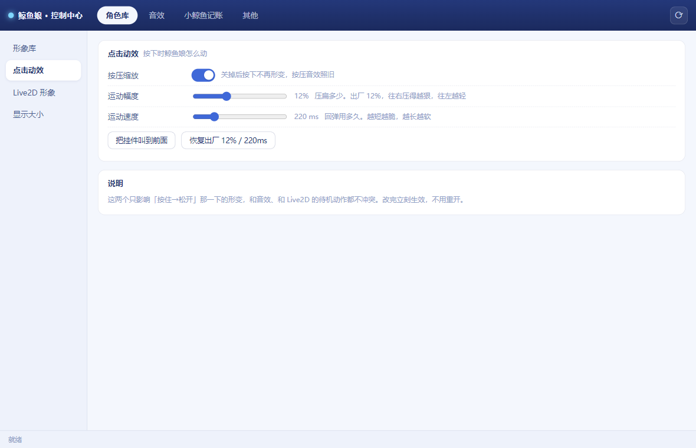
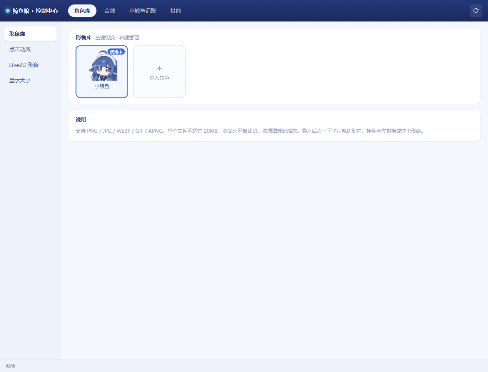
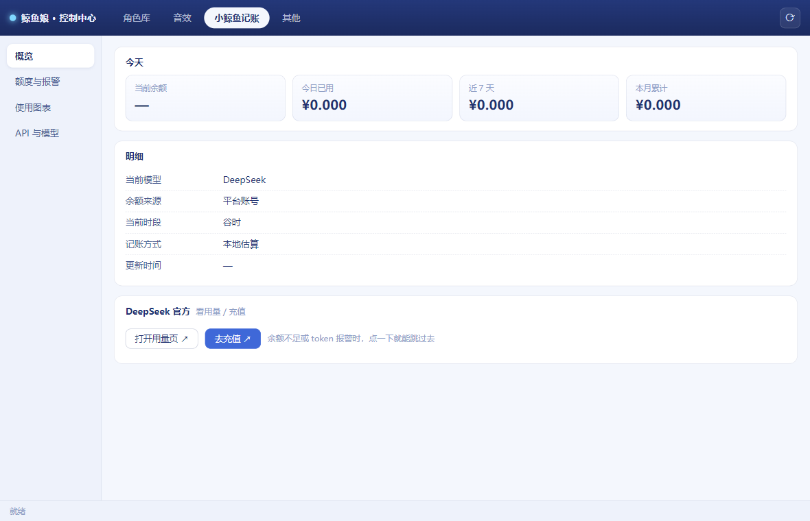

# 小鲸鱼 · 桌面增强升级包

> ## ⚠️ 先看这里：本包已脱敏，程序**不完整**，装之前必须先按 README 配置
>
> 发布前做过自动脱敏：账号、本机路径、称呼、角色名、世界观名词全部替换成了 `<...>` 占位符。
> **直接解压就装是跑不起来的** —— 语音人格是空壳、音色 provider id 不存在、示例路径对不上你的机器，
> 表现是"界面能开但不会说话 / 一开口服务就报错"。
>
> 正确顺序只有一条：
> 1. 解压到一个有写权限的目录（别放 `Program Files`）
> 2. **先按 zip 内 `README.md` 第 7 节的占位符表，把 `<...>` 改成你自己机器的真实值**
> 3. 再执行 `install.ps1`
>
> 最小必改集合：`<CHAR_NAME>` `<CHAR_ALIAS>` `<USER_TITLE>` `<WORLD_SERIES>` `<WORLD_PLACE>` `<WORLD_SCHOOL>` `<WORLD_DEPT>` `<WORLD_THREAT>` `<TTS_PROVIDER_ID>`。

依附鲸鱼娘本体（`WhaleDesktop`）运行的桌面增强升级包。
**包里不含 exe、不含挂件本体**，挂件从你已经装好的本体里取；语音服务复用本体的 Python 环境、模型和音色。

## 这是什么

本来只是个余额挂件，这层升级把它做成了能聊天、能看屏幕、能出声的桌面搭子：

- **气泡聊天**：点鲸鱼就说话，回落气泡，不挡桌面
- **控制中心**：尺寸、位置、透明穿透、气泡、音效、记账、报警一盘管子
- **多平台记账**：内置账本之外，可加 OpenAI 兼容中转站与各家 API 平台，按余额观测记账
- **用量图表**：日/周柱状图，官方用量页 / 充值页一键直达
- **额度与报警**：日/月预算、余额不足、超预算通知
- **窥屏吐槽**：截屏 → 视觉模型 → 一句吐槽
- **语音朗读 + 按住说话**：TTS 出声，热键按住说话走 STT，再接 LLM 回复
- **Live2D 形象层**：换模型、点击动作分组、表情、视线跟随

## 下载

| 文件 | 说明 |
| --- | --- |
| `whale-desktop-upgrade-0.1.0.zip` | 最新升级包（依附本体，约 1 MB）· 本仓库根目录直接下载 |

> 旧版 1.0.0 / 1.0.1 那两个 zip 已下架，不再保留。

## 安装

```powershell
# 1) 解压到一个有写权限的目录
# 2) 按 zip 内 README.md 第 7 节替换 <...> 占位符
# 3) 自动找已装的本体并安装
powershell -ExecutionPolicy Bypass -File install.ps1

# 找不到本体就手动指定
powershell -ExecutionPolicy Bypass -File install.ps1 -HostDir "D:\你装鲸鱼娘的目录"

# 只体检，不动任何文件
powershell -ExecutionPolicy Bypass -File install.ps1 -Check
```

装完用 `start.cmd` 起服务 + 界面；`whale.ps1 start` 只起后台服务。

## 和完整包的区别

| | 升级包（本仓库） | 完整包 `WhaleDesktop-*-win-x64.zip` |
| --- | --- | --- |
| 体积 | 约 1 MB | 100 MB+ |
| exe / 挂件本体 | 不含，从已装本体取 | 全都有 |
| Python / 模型 / 音色 | 复用本体的 | 自带 |
| 前提 | 必须先装好本体 | 解压即用 |

## 前置要求

1. 已安装的鲸鱼娘本体 —— 判定：目录里有 `main.js` 和 `vendor\whale-widget\assets\whale-widget.js`
2. Node.js 18+
3. 可选：Python 3.12 + 依赖（STT / TTS / 窥屏 / 语音聊天）、GPT-SoVITS（`api_v2.py` 起在 9880）、参考音色 `ref.wav`

## 环境变量

| 变量 | 作用 |
| --- | --- |
| `WHALE_HOST_DIR` | 指定本体目录（等价于 `install.ps1 -HostDir`） |
| `WHALE_PORT` | 本地宿主端口（默认 32168） |
| `WHALE_TTS_PROVIDER_ID` | 音色 provider id（等价于替换 `<TTS_PROVIDER_ID>`） |
| `WHALE_GSV_URL` | GPT-SoVITS 地址（默认 `http://127.0.0.1:9880`） |

## 界面






## 数据与隐私

- 余额、账本、Live2D 模型、配置落在本体的用户数据目录，不进安装目录
- 日志写在用户数据目录的 `logs/`，不含密钥
- 包里没有任何硬编码密钥或账号，第一次用需要在「账号与余额」里填自己的 API Key
- 包里**不含**：`vendor\whale-widget`（从本体取）、`node_modules`（npm 装）、`ref.wav`、`models`、`paths.json`、日志、缓存、录音、截图

## 已知边界

- 非 DeepSeek 平台没有「每日历史」接口，多平台图表靠每 5 分钟采样，历史从开始采样那天往后才有
- 无余额接口的平台只能按会话事件估算，精度低于余额观测式记账
- 脱敏后的占位符必须自己替换，作者不会替你填

## 更新记录

- **0.1.0**：改成依附本体的升级包形态（不含 exe / 挂件本体），`install.ps1` 自动定位本体并复用它的 Python、模型、音色；新增 `start.cmd` 一键启动；README 补占位符表与脱敏提示
- ~~1.0.1 / 1.0.0~~：已下架
